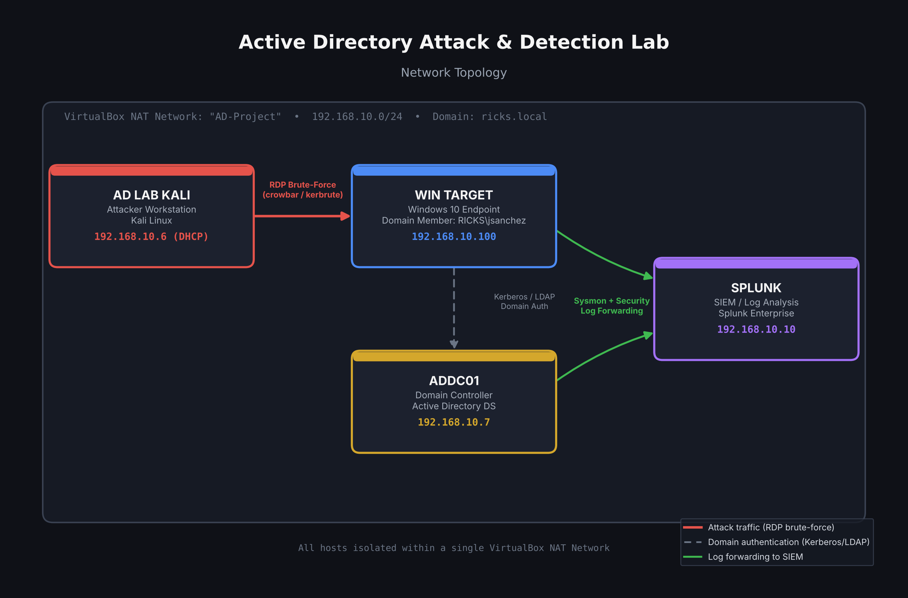

# Active Directory Attack & Detection Lab

A self-hosted home lab simulating a real-world attack chain against an Active Directory environment — from initial brute-force compromise through SIEM-based detection and MITRE ATT&CK-mapped threat emulation.

Built end-to-end in VirtualBox: a Windows Server domain controller, a domain-joined Windows 10 endpoint, a Kali Linux attacker machine, and a Splunk Enterprise SIEM — all isolated on a single internal network.

> Inspired by MyDFIR's "Active Directory Home Lab" series, rebuilt from scratch with my own domain, users, and infrastructure, and extended with my own troubleshooting, tooling decisions, and detection queries throughout.

---

## Table of Contents

- [Environment Overview](#environment-overview)
- [Network Topology](#network-topology)
- [Phase 1: Active Directory Setup](#phase-1-active-directory-setup)
- [Phase 2: Attack Simulation — RDP Brute-Force](#phase-2-attack-simulation--rdp-brute-force)
- [Phase 3: Detection in Splunk](#phase-3-detection-in-splunk)
- [Phase 4: Threat Emulation with Atomic Red Team](#phase-4-threat-emulation-with-atomic-red-team)
- [Challenges & Troubleshooting](#challenges--troubleshooting)
- [MITRE ATT&CK Mapping](#mitre-attck-mapping)
- [Key Takeaways](#key-takeaways)
- [Tools Used](#tools-used)

---

## Environment Overview

| Host | Role | OS | IP Address |
|---|---|---|---|
| **ADDC01** | Domain Controller | Windows Server | `192.168.10.7` |
| **Win Target** | Domain-joined endpoint | Windows 10 | `192.168.10.100` |
| **AD LAB KALI** | Attacker machine | Kali Linux | `192.168.10.6` (DHCP) |
| **SPLUNK** | SIEM / log analysis | Splunk Enterprise (Ubuntu) | `192.168.10.10` |

**Domain:** `ricks.local`
**Network:** All four VMs isolated on a single VirtualBox NAT Network (`AD-Project`, `192.168.10.0/24`)
**Target user:** `RICKS\jsanchez` (IT OU)

---

## Network Topology



---

## Phase 1: Active Directory Setup

Built a functioning Active Directory domain from the ground up:

- Promoted **ADDC01** to a domain controller for `ricks.local`
- Created organizational units (IT, HR, Users) and populated them with domain users
- Joined **Win Target** (Windows 10) to the domain
- Configured the target user account (`jsanchez`) with Remote Desktop access enabled for the attack simulation phase

📸 *See `screenshots/01-setup/` for AD Users and Computers configuration and domain join evidence.*

---

## Phase 2: Attack Simulation — RDP Brute-Force

**Goal:** Simulate an external attacker brute-forcing RDP credentials against a domain-joined endpoint, from a separate attacker machine on the same network.

### Setup

- Enabled Remote Desktop on **Win Target**, authorizing the `jsanchez` domain account
- Prepared a password wordlist on Kali using a trimmed sample from `rockyou.txt`, with the target's real password appended to guarantee a match
- Configured Kali's DNS and `/etc/krb5.conf` to correctly resolve the `ricks.local` Kerberos realm against `ADDC01`

### Execution

The brute-force was carried out using **kerbrute**, a Kerberos pre-authentication-based credential-testing tool, after initial attempts with `crowbar` and `Hydra` ran into tooling issues (documented below in [Challenges & Troubleshooting](#challenges--troubleshooting)).

```bash
kerbrute bruteuser -d ricks.local --dc 192.168.10.7 password.txt jsanchez
```

**Result:** `[+] VALID LOGIN: jsanchez@ricks.local:********` — credential confirmed, followed by a live RDP session into Win Target as `jsanchez`.

📸 *See `screenshots/02-attack/` for the brute-force success output and confirmed RDP access.*

---

## Phase 3: Detection in Splunk

With the attack complete, the focus shifted to hunting the resulting telemetry in Splunk — confirming the attack was actually visible to a defender.

### Setup Note

Universal Forwarders on **ADDC01** and **Win Target** were already shipping Windows Security and Sysmon logs into Splunk's `endpoint` index prior to the attack.

### Hunting the Attack

Searched for the target user's activity across both hosts:

```spl
index=endpoint jsanchez EventCode=4625
| table _time, host, Account_Name, Logon_Type, Failure_Reason
| sort -_time
```

This surfaced a dense burst of **161 failed logon events (Event ID 4625)** on `target-pc` over a roughly 20-minute window — "Unknown user name or bad password," matching the brute-force wordlist run — followed by a successful logon (**Event ID 4624**) within minutes of the burst ending.

**Detection pattern confirmed:** repeated authentication failures against a single account from a single source, in rapid succession, followed by a success — a textbook brute-force signature.

📸 *See `screenshots/03-detection/` for the full failed-logon burst and the matching successful-logon event.*

---

## Phase 4: Threat Emulation with Atomic Red Team

To go beyond a single attack technique, I used [Atomic Red Team](https://github.com/redcanaryco/invoke-atomicredteam) to emulate two additional MITRE ATT&CK techniques directly on **Win Target**, then verified each was captured in Splunk.

### T1136.001 — Create Account: Local Account

```powershell
Invoke-AtomicTest T1136.001
```

Created a local account (`NewLocalUser`) and added it to the local Administrators group — simulating an attacker establishing persistence after initial access.

**Detection:** confirmed in Splunk via Sysmon process-creation telemetry showing the full `net.exe` → `net1.exe user NewLocalUser` command chain, attributed to `RICKS\jsanchez`.

### T1059.001 — Command and Scripting Interpreter: PowerShell

```powershell
Invoke-AtomicTest T1059.001
```

Executed a PowerShell command-execution test. Several sub-tests requiring external payloads (Mimikatz, BloodHound) failed due to local privilege boundaries and missing prerequisites — expected behavior in a hardened, domain-joined environment — while the core PowerShell execution sub-test completed successfully.

**Detection:** confirmed in Splunk via Sysmon events pre-tagged with `technique_id=T1059.001, technique_name=PowerShell`.

📸 *See `screenshots/04-atomic-redteam/` for execution evidence and `screenshots/03-detection/` for the corresponding Splunk detections.*

---

## Challenges & Troubleshooting

This lab didn't go cleanly on the first try — and I think the troubleshooting is as valuable to show as the final result.

| Issue | Root Cause | Resolution |
|---|---|---|
| `crowbar` returned "No results found" instantly | Outdated `/cert-ignore` flag vs. current FreeRDP's `/cert:ignore` syntax, plus stale DNS/Kerberos config on Kali | Patched crowbar's source, corrected DNS to point at the DC, added `/etc/krb5.conf` |
| Large Kerberos clock skew between Kali and the DC | DC had no real NTP source | Synced time via `ntpdate` against the DC |
| Hydra's RDP module silently failed to report a correct password | Known bug in Hydra's experimental RDP module | Confirmed via `BadPwdCount` math and verbose output; abandoned Hydra for RDP |
| Hydra's SMB brute-force hung indefinitely | Windows Firewall silently dropping port 445 | Confirmed via `nmap`; SMB ruled out as an attack vector |
| Repeated failed brute-force attempts across multiple tools | The account's actual password had drifted from what was assumed | Reset via `Set-ADAccountPassword`, confirmed via direct GUI login test |
| Splunk license expired, blocking all searches | Enterprise Trial license expired | Attempted web UI license-group change didn't persist; resolved via direct CLI: `splunk edit licenser-groups Free -is_active 1` |
| No Kerberos pre-authentication failure events (4771) logged | DC's default audit policy doesn't enable Kerberos Authentication Service auditing | Pivoted detection strategy to RDP-layer Event IDs (4624/4625), which were enabled by default |

---

## MITRE ATT&CK Mapping

| Technique ID | Technique Name | Tactic | Status |
|---|---|---|---|
| T1110 | Brute Force | Credential Access | ✅ Executed & Detected |
| T1021.001 | Remote Desktop Protocol | Lateral Movement | ✅ Executed & Detected |
| T1136.001 | Create Account: Local Account | Persistence | ✅ Executed & Detected |
| T1059.001 | PowerShell | Execution | ✅ Executed & Detected |

---

## Key Takeaways

- A brute-force attack against a domain account is loud and highly detectable, even with only default Windows auditing enabled — the 4625/4624 pattern alone is enough to catch it.
- Tooling reliability matters: three different brute-force tools (crowbar, Hydra, kerbrute) behaved differently against the same target, and understanding *why* each one failed was as important as getting one to succeed.
- Default audit policies have real visibility gaps — Kerberos-specific events weren't logged at all in this environment, which is itself a useful finding for hardening recommendations.
- Atomic Red Team is a fast way to validate whether specific MITRE ATT&CK techniques actually generate visible telemetry in a given SIEM configuration, rather than assuming detection coverage.

---

## Tools Used

- **VirtualBox** — virtualization platform
- **Active Directory Domain Services** — identity infrastructure
- **Kali Linux** — attacker platform (`kerbrute`, `crowbar`, `Hydra`, `nmap`)
- **Splunk Enterprise** — SIEM / log analysis
- **Atomic Red Team** — MITRE ATT&CK technique emulation
- **Sysmon** — endpoint telemetry

---

## Repository Structure

```
screenshots/
├── 01-setup/           # AD configuration, topology diagram
├── 02-attack/          # Brute-force execution, RDP access, troubleshooting evidence
├── 03-detection/       # Splunk queries and detection results
└── 04-atomic-redteam/  # Atomic Red Team execution evidence
```
